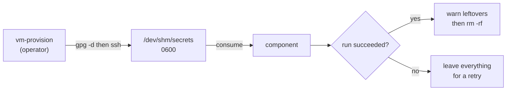

# agentvm

Setup script for throwaway Debian VMs that run an autonomous coding agent.

The VM is disposable: the point is to give an agent a machine it can have root
on, without exposing the host. This script performs the one-time "first login"
setup on a fresh Debian VM — packages, dev tooling, shell environment, and
credential wiring — from a modular list of components selected by the VM's
hostname.

It is meant to be run **once** per VM, immediately after first boot.

## Requirements

- Debian Trixie, GNOME desktop, standard system utilities.
- A user with passwordless `sudo`. (`vm-new` provisions
  `sudo: ALL=(ALL) NOPASSWD:ALL` through cloud-init)
- `curl` (`sudo apt install curl`) if you use the one-liner.
- Network access to GitHub, `omp.sh`, `mise.run`, and Debian mirrors.

## Quick start

```bash
sudo apt install curl
bash -c "$(curl -fsSL https://mfgo.link/agentvm)"
```

Or from a checkout:

```bash
./agentvm.bash
```

Secrets are pushed separately, before running the script. You need **two
terminals** for that: one logged into the guest, one on your host to push the
secrets. See [You need two terminals](#you-need-two-terminals) before you start,
or the secrets will be discarded before the script can read them.

## Selecting what gets installed

VMs are named `omp-PROJECT`. The script strips the prefix and runs
`project_PROJECT`:

| Hostname        | Project function               |
| --------------- | ------------------------------ |
| `omp-agentvm`   | `project_agentvm`              |
| `omp-opentower` | `project_opentower`            |
| `omp-recueil`   | `project_recueil`              |
| anything else   | `project_default` (everything) |

`AGENTVM_PROJECT` overrides the detection, which is useful when testing or when
the hostname does not follow the convention:

```bash
AGENTVM_PROJECT=opentower ./agentvm.bash
```

### Projects

A project is a function that declares what it wants but doesn't install anything
itself. Most projects start from the shared baseline and add to it:

```bash
use_standard      # base editor git bash screen fonts mise omp ntfy agentvm

project_opentower() {
  use_standard
  use buildtools rust
  use ghidra dosbox rea
  apt_extra libasound2-dev
}

project_recueil() {
  use_standard
  use buildtools go node docker
  mise_global sqlc@1
  repo mfinelli/recueil
}
```

`apt_extra` is for a package that does not justify its own component yet.
Promote it to a component when it makes sense.

`npm_global` is the same idea for npm: it records packages that are installed
with one `npm install -g` after every component has run, and selects `node` so
that npm and a writable prefix exist:

```bash
project_agentvm() {
  use_standard
  npm_global prettier@3
}
```

The install needs no `sudo`: mise's node prefix is user-writable, and the
binaries land in `~/.local/share/mise/shims`, which `component_node` puts on
`PATH`. Entries are passed to npm verbatim, so pinning is up to the caller.

`--list` reports them as `npm packages: prettier@3`.

`mise_global` is the same idea for tools no apt suite carries, installed with
one `mise use -g` after every component has run:

```bash
project_agentvm() {
  use_standard
  apt_extra shellcheck shfmt
  npm_global prettier@3
  mise_global "aqua:rhysd/actionlint@1"
}
```

`--list` reports them as `mise tools: aqua:rhysd/actionlint@1`.

`repo` declares the repositories the project actually works on and are cloned
into `~/src`:

```bash
project_agentvm() {
  use_standard
  repo mfinelli/agentvm
}
```

`owner/name` is shorthand for `https://github.com/owner/name.git`; a full https
or ssh URL is used verbatim, and the directory name comes from the URL.

Clones are `--recurse-submodules`, and an existing checkout gets
`git submodule update --init --recursive` on every run.

`--list` reports them as `repos: mfinelli/agentvm`.

### Components

Each component is one `component_<name>` function. `COMPONENTS` is the registry,
and **its order is the execution order**:

```
base editor git bash screen fonts java ghidra buildtools re rust dosbox \
  mise go node docker omp ntfy rea agentvm repos
```

Declaring a dependency doesn't reorder anything; it only widens what a project
pulls in:

```bash
declare -A DEPENDS=(
  [bash]='git'
  [ghidra]='java'
  [go]='mise'
  [node]='mise'
  [ntfy]='omp'
  [rea]='node re'
)
```

So `use rea` is enough to get `node`, `mise` and `re` too. Three invariants are
checked at startup and abort with exit 2:

- a dependency must exist in `COMPONENTS`;
- a component may not depend on itself;
- a dependency must appear _earlier_ in `COMPONENTS` than its dependent.

### Applying a single component later

A VM is not frozen when the first run finishes. `--only` applies named
components on their own, pulling in whatever they depend on and ignoring the
project entirely:

```bash
./agentvm.bash --only screen          # screen, no secrets, no other component
./agentvm.bash --only rea             # + re, node, mise as dependencies
./agentvm.bash --only screen,rea      # comma or space separated
./agentvm.bash --only screen --list   # preview first
```

`--only` also works on a host whose name does not follow `omp-PROJECT`, which is
the point: it is for patching a machine that is already set up.

A targeted apply does not need secrets unless the components it names consume
one, and it **never sweeps** `/dev/shm/secrets`. Sweeping is a full-run
operation, because a partial run cannot tell an unconsumed secret from one that
belongs to a run still to come.

### Self-install

`component_agentvm` keeps a checkout of this repo at `~/.agentvm` and symlinks
it into `~/.local/bin/agentvm`, which is already on `PATH`. It is part of
`use_standard`, so every VM built by this script ends up with one:

```bash
agentvm --update                # git pull the checkout, then exit
agentvm --only <new component>  # apply something added since this VM was built
```

That is the upgrade path for a VM built from an older revision: update the
checkout, then apply the component that did not exist when the VM was made. No
path to remember — `~/.local/bin` is where `mise` and `omp` already live.

Three details worth knowing:

- **It updates, it does not re-clone.** An existing `~/.agentvm` gets
  `git pull --ff-only`, so local edits are never destroyed. Only a missing or
  empty directory triggers a clone.
- **Nothing is deleted.** If `~/.agentvm` exists but is not a checkout, or if
  `~/.local/bin/agentvm` exists but is not a symlink, the component stops and
  says which variable (`AGENTVM_DIR`, `AGENTVM_LINK`) to set. A stale symlink
  pointing somewhere else is repointed.
- **No secret is required.** It installs the `git` _package_ if the binary is
  missing, rather than depending on the `git` component, which would also demand
  the identity and token secrets. Fetching a public repo should not need a
  token, and a VM that was never provisioned can still self-install.

### Inspecting a project without changing anything

```bash
./agentvm.bash --list          # components, deps, extra packages, secrets
AGENTVM_DRY_RUN=1 ./agentvm.bash   # print the commands instead of running them
```

`--list` prints dependencies indented and marked:

```
$ AGENTVM_PROJECT=opentower ./agentvm.bash --list
project: opentower
base
editor
git
bash
screen
fonts
  java (dependency)
ghidra
buildtools
  re (dependency)
rust
dosbox
mise
  node (dependency)
omp
ntfy
rea
extra packages: libasound2-dev
secrets: git-name git-email github-token ollama-token
```

## Secrets

No secrets are baked into the VM image. Secrets are pushed into the guest at
`/dev/shm/secrets` (RAM only) by `vm-provision`, which lives in my
[dotfiles](https://github.com/mfinelli/dotfiles) repo
(`roles/zsh/files/libvirt.zsh`) alongside the other libvirt helpers.

The dotfiles provisions the secrets:

```
~/.local/share/vm-secrets/
  git-name.asc        # GPG-encrypted
  git-email.asc
  github-token.asc
```

```bash
vm-provision omp-agentvm
```

`vm-provision` decrypts each file locally and pipes it over the SSH connection.

### You need two terminals

`/dev/shm/secrets` only survives while the target user has a login session open.
`systemd-logind` defaults to `RemoveIPC=yes`, and when the last session of a
user ends it unlinks every `/dev/shm` entry owned by that UID. The SSH
connection `vm-provision` uses is its own session, so provisioning into a VM you
are not otherwise logged into deletes the secrets again the moment that
connection closes (i.e., before `agentvm.bash` can read them).

Keep a session open for the whole sequence:

1. **Terminal A — inside the guest.** `vm-ssh omp-agentvm`, or a VNC/console
   session (`vm-vnc omp-agentvm`). Leave it logged in. Any session for the VM's
   user pins the user record and keeps the cleanup from running.
2. **Terminal B — on your main host.** `vm-provision omp-agentvm`, then run the
   setup script over SSH in that same window:

   ```bash
   vm-provision omp-agentvm
   vm-ssh omp-agentvm 'bash -c "$(curl -fsSL https://mfgo.link/agentvm)"'
   ```

   Pass the remote command as a single quoted argument: `vm-ssh` hands its extra
   arguments straight to `ssh`, which joins them and lets the _remote_ shell
   re-split the line.

   Do not log out of Terminal A, and do not let it idle out, until the run
   finishes. If the guest is a desktop VM with GDM auto-login, the graphical
   session already counts — but only while it is logged in.

### Consumption

A secret becomes required as soon as a selected component uses it —
`SECRET_USERS` maps secret to consumer, so projects never mention secrets:

```bash
declare -A SECRET_DEST=(          # where the file is installed; "" = a value
  [git-name]=""
  [git-email]=""
  [github-token]="$HOME/.config/git/tokens/github.com"
  [ollama-token]=""
)
declare -A SECRET_USERS=(         # which component consumes it
  [git-name]='git'
  [git-email]='git'
  [github-token]='git'
  [ollama-token]='omp'
)
```

Components read them with `secret_value VAR` (a value) or `take_secret` (a
file). A value secret that is empty is rejected **before** it is deleted, so a
retry reports the same error instead of failing at the preflight with the
evidence gone. The lifecycle is:



- **Missing required secret → exit 3 before anything is installed.** A VM that
  was never provisioned fails immediately instead of half-way through the run.
- **Consumed secrets are installed and deleted**; a second run without
  re-provisioning therefore fails loudly. That is deliberate: the script is a
  one-shot.
- **Leftovers are warned about but removed.** Provisioning pushes a fixed set,
  so a project that installs no node still receives `npmrc`. Unknown names are
  reported distinctly (`npmrc (unknown)`) to make a typo findable.
- **An aborted run doesn't sweep anything**, so fixing the cause and re-running
  works.
- **`--list` and dry run don't consume or delete.** Both still run the preflight
  check, so a missing secret is reported in dry run too.

## Git authentication

HTTPS with a read-only personal access token, not SSH keys: a key cannot be
scoped to repositories or made read-only, a fine-grained PAT can.

`component_git` installs the token at `~/.config/git/tokens/github.com` and
configures a credential helper scoped to that host only:

```bash
git config --global credential.https://github.com.helper \
  '!f() { [ "$1" = get ] && { echo username=x-access-token; echo "password=$(cat ~/.config/git/tokens/github.com)"; }; }; f'
```

Consequences:

- Nothing is written to `~/.git-credentials`.
- The helper answers `get` only, so git never persists the token.
- A second provider gets its own file and its own scoped helper
  (`tokens/gitlab.com` + `credential.https://gitlab.com.helper`); a host-scoped
  helper is never offered to a different host.
- The helper matches on host, **not** repository. Anything in the VM can clone
  any repository the token can read. Read-only limits damage, not reach.

Create a token with `contents: read` only:

```
https://github.com/settings/personal-access-tokens/new?name=VM+read+token&contents=read&expires_in=45
```

## oh-my-pi

omp keeps its configuration in `~/.omp/agent/config.yml` (mode `0600`), which
`omp config` maintains. `component_omp` writes the settings that would otherwise
need a first-run wizard, using the same command:

| Key                  | Value                              | Why                                                        |
| -------------------- | ---------------------------------- | ---------------------------------------------------------- |
| `modelRoles.default` | `ollama-cloud/deepseek-v4.1-flash` | the startup model; `/model` still overrides it per session |
| `composer.shape`     | `pi`                               | the "Pi" composer from the first-run picker                |
| `symbolPreset`       | `nerd`                             | Nerd Font glyphs, matching the `fonts` component           |
| `theme.dark`         | `titanium`                         |                                                            |
| `theme.light`        | `light`                            |                                                            |

Override any of them without editing the script:

```bash
AGENTVM_OMP_MODEL=ollama-cloud/kimi-k2 \
AGENTVM_OMP_SYMBOL_PRESET=unicode \
  ./agentvm.bash --only omp
```

`omp config list` prints every key with its allowed values, so the set of valid
choices is discoverable on the VM rather than fixed here. `theme.dark` and
`theme.light` are a pair: omp picks between them from the terminal's reported
background, which is also what `--use-theme` overrides for one run.

`modelRoles` is a record and cannot be set key by key —
`omp config set modelRoles.default …` fails with `Unknown setting`. The
component therefore reads the current record and merges `default` into it, so a
`smol`, `slow` or `plan` role chosen earlier survives.

### The token

`ollama-token` holds **only the literal API key** — the same string you would
give `OLLAMA_CLOUD_API_KEY`. It is not the JSON envelope:

```bash
# ~/.local/share/vm-secrets/ollama-token.asc contains exactly this:
sk-ollama-...
```

The envelope exists only inside the component. `omp auth import` wants a
versioned document, so the component builds it _around_ your token:

```bash
printf '%s' "$envelope" | omp auth import -
```

Two consequences worth stating, since both are easy to get wrong:

- **Do not paste an auth export.** `omp auth export` output is a JSON envelope;
  putting it in the secret file would be accepted by `omp auth import` and
  stored as the literal key, failing only at the first API call. The component
  rejects a token that starts with `{` and says which file to inspect.
- **A trailing newline is fine.** `secret_value` strips it, so both
  `echo KEY > file` and `printf KEY > file` work.

The envelope is built by `python3` so a key containing a quote or backslash
cannot corrupt the JSON, and it is passed on **stdin** rather than as an
argument — an argument is visible in `/proc/<pid>/cmdline` to every user on the
machine. Verify the result with `omp token ollama-cloud`, which prints the key
that was actually stored.

## What gets installed

| Component    | Contents                                                                                      |
| ------------ | --------------------------------------------------------------------------------------------- |
| `base`       | curl wget htop bat python3 python3-pip magic-wormhole imagemagick 7zip libarchive-tools unzip |
| `editor`     | vim, `EDITOR=vim`                                                                             |
| `git`        | git, identity from secrets, host-scoped token helper                                          |
| `bash`       | bash-it in `~/.bashit` (minimal theme, command duration), `~/src`                             |
| `screen`     | screen, `~/.screenrc` with a status line (see below)                                          |
| `fonts`      | AdwaitaMono Nerd Font                                                                         |
| `java`       | openjdk-25-jdk                                                                                |
| `ghidra`     | Ghidra 12.2 in `~/Downloads`, `GHIDRA_INSTALL_DIR`                                            |
| `buildtools` | gcc make pkg-config                                                                           |
| `re`         | binutils binwalk                                                                              |
| `rust`       | rustup + stable toolchain                                                                     |
| `dosbox`     | dosbox-x                                                                                      |
| `mise`       | mise, then `~/.local/bin` on PATH                                                             |
| `go`         | `mise use -g go@1.27`, `~/go/bin` on PATH for `go install`                                    |
| `node`       | `mise use -g node@lts pnpm@12`                                                                |
| `docker`     | docker.io docker-cli docker-compose, daemon enabled, user in the `docker` group               |
| `omp`        | oh-my-pi, `~/agentvm` PATH entry, Ollama Cloud token, appearance settings                     |
| `ntfy`       | omp-ntfy plugin, its config file, and the same values in `~/.bashrc`                          |
| `rea`        | `npx rea-agents setup`                                                                        |
| `agentvm`    | checkout at `~/.agentvm`, symlinked to `~/.local/bin/agentvm`                                 |
| `repos`      | full clones of `repo` declarations in `~/src`                                                 |

`~/.bashrc` lines are appended idempotently: re-running the script does not
duplicate them. `~/.screenrc` is written whole, and only when its content
differs, so a re-run neither rewrites the file nor discards local edits
silently.

## Screen

Working over SSH means two jobs share one terminal: the agent, and whatever you
are doing next to it. `component_screen` installs screen and writes a
`~/.screenrc` whose last line is:

```
[omp-agentvm][0 agent][omp UTC 00:29Z]                      [1 shell]
 └ hostname    └ current └ session, UTC                      └ other windows
```

- **Which window is current** is always visible, because it is pinned in the
  fixed left block rather than inferred from a `*` in the list.
- **The list holds the other windows only** (`%W`), so the current one is not
  printed twice. At narrow widths the list truncates and the fixed block
  survives; at 40 columns only the fixed block remains.
- **`[CMD]` appears** when you press the command character, so you can see
  screen is waiting for the rest of a command.

Two defaults worth knowing:

- `C-a` is still the command character. omp binds `C-a` to "move to line start",
  so inside the agent that key now needs `C-a a` to reach it.
- Window 0 is a plain shell. A broken or absent `omp` cannot then leave you with
  a dead window, and you choose what each window runs. The last `screen -t` line
  in `.screenrc` is the window screen lands on — a `select` line does not do
  this for a detached session — so `agent` is listed last to make it the one you
  attach to.

### Italic and truecolor

Two screen limits, only one of which is a config problem.

Italic **works**: the screenrc contains

```
termcapinfo * so=\E[3m:se=\E[23m
```

The reason it is needed is that screen 4.9 (Debian trixie) has no italic
attribute at all. Its rendition table maps SGR 3 onto _standout_, and standout
is emitted with the outer terminal's `smso`, which `xterm-256color` defines as
`\E[7m`. Italic text therefore rendered as reverse video — grey background,
black foreground. Repointing `so` at `\E[3m` is what lets SGR 3 reach the
terminal as italic. Genuine reverse video (SGR 7) goes through `mr` and still
works.

Truecolor does **not** work, and cannot be fixed from `.screenrc`. screen 4.9
stores colour as an 8-bit pair and parses only `38;5;N`; a `38;2;r;g;b` sequence
matches no case and is dropped, so a truecolor application silently falls back
to the terminal's default colour. The `truecolor on` command that enables 24-bit
pass-through was added in screen 5.0, which is in Debian forky but not trixie or
trixie-backports.

Revisit this once Debian 14 (forky) is released and the base image has been
upgraded: `component_screen` needs `truecolor on` and the `termcapinfo` line
becomes redundant.

## Adding a project

1. Add a `project_<name>` function next to the others, starting from
   `use_standard` and adding what the project needs.
2. If it needs a new package that is genuinely project-specific, use `apt_extra`
   for apt, `npm_global` for a global npm tool, or `mise_global` for something
   no apt suite carries. A repository the project works on goes in `repo`, which
   clones it into `~/src` and selects the `git` component. If it needs a new
   piece of tooling, add a `component_<name>`, register it in `COMPONENTS` in
   the right position, and add any `DEPENDS` edges.

Name the VM `omp-<name>` and the project function is picked up automatically.

## Tests

`bats` tests live in `tests/` and are run with `just test`:

```bash
just test              # every test
just test -f secrets   # only tests whose name matches
```

The suite covers the parts of `agentvm.bash` that touch neither the network nor
the system: `_want`'s dependency walk, the secret lifecycle (empty secrets are
rejected _before_ the file is deleted, file secrets land at 0600),
`install_config` idempotency, and `component_repos`' URL and directory rules
with a stubbed git.

Three things about the suite are deliberate and easy to break:

- **Every test starts with `set -e`.** bats judges a test by the status of its
  _last_ command, so a failing assertion in the middle is silently ignored if a
  later one passes — a test that reads `[ "$status" -eq 3 ]` followed by
  `[ -f "$x" ]` passes even when the status is wrong. `set -e` makes the first
  failure fatal.
- **The script's `run` helper is kept as `agentvm_run`.** It shadows bats'
  `run`, and calling it through bats' `run` does not work: the inner call
  re-resolves `run` in the subshell and finds bats' version again.
- **The entry-point guard is `if ! (return 0 2> /dev/null); then main; fi`, not
  a `BASH_SOURCE` comparison.** The file is a library when bats `load`s it and a
  script when provisioning runs it, and `BASH_SOURCE` cannot tell those apart
  reliably: under `bash -c "$(curl ...)"` it is _unset_, which `set -u` turns
  into an abort, and under `curl ... | bash` it is a synthetic `main`. A
  `return` only succeeds in a sourced file, so the subshell is the real test.
  Test 32 exercises every invocation mode; keep it passing.

## Limitations

- Throwaway VM by design: the user gets `NOPASSWD` sudo, and the agent is root
  in practice. Secrets are readable by the agent while it runs.
- One-shot: a second run fails at the secret preflight. Re-run `vm-provision`
  first.
- `ntfy` defaults to `http://192.168.123.1:8081`, the libvirt NAT gateway. Set
  `AGENTVM_NTFY_SERVER` and/or `AGENTVM_NTFY_TOPIC` for a different network or
  topic.
- `vm-provision`, `vm-new` and the rest of the VM lifecycle live in my
  [dotfiles](https://github.com/mfinelli/dotfiles) repo.

## License

Mozilla Public License 2.0 — see [LICENSE](LICENSE).
