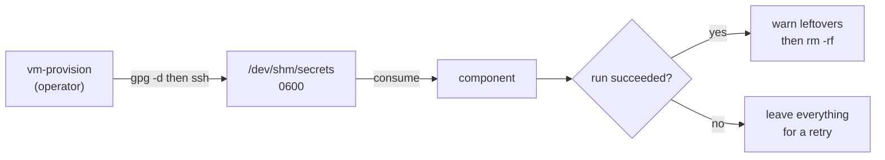

# agentvm

Setup script for throwaway Debian VMs that run an autonomous coding agent.

The VM is disposable: the point is to give an agent a machine it can have root
on, without exposing the host. This script performs the one-time "first login"
setup on a fresh Debian VM — packages, dev tooling, shell environment, and
credential wiring — from a modular list of components selected by the VM's
hostname.

It is meant to be run **once** per VM, immediately after first boot.

## Requirements

- Debian Trixie, GNOME desktop, standard system utilities.
- A user with passwordless `sudo`. (`vm-new` provisions
  `sudo: ALL=(ALL) NOPASSWD:ALL` through cloud-init)
- `curl` (`sudo apt install curl`) if you use the one-liner.
- Network access to GitHub, `omp.sh`, `mise.run`, and Debian mirrors.

## Quick start

```bash
sudo apt install curl
bash -c "$(curl -fsSL https://mfgo.link/agentvm)"
```

Or from a checkout:

```bash
./agentvm.bash
```

Secrets are pushed separately, before running the script — see
[Secrets](#secrets).

## Selecting what gets installed

VMs are named `omp-PROJECT`. The script strips the prefix and runs
`project_PROJECT`:

| Hostname        | Project function               |
|-----------------|--------------------------------|
| `omp-agentvm`   | `project_agentvm`              |
| `omp-opentower` | `project_opentower`            |
| anything else   | `project_default` (everything) |

`AGENTVM_PROJECT` overrides the detection, which is useful when testing or
when the hostname does not follow the convention:

```bash
AGENTVM_PROJECT=opentower ./agentvm.bash
```

### Projects

A project is a function that declares what it wants but doesn't install
anything itself. Most projects start from the shared baseline and add to it:

```bash
use_standard      # base editor git bash fonts mise omp ntfy

project_opentower() {
  use_standard
  use buildtools rust
  use ghidra dosbox rea
  apt_extra libasound2-dev
}
```

`apt_extra` is for a package that does not justify its own component yet.
Promote it to a component when it makes sense.

### Components

Each component is one `component_<name>` function. `COMPONENTS` is the
registry, and **its order is the execution order**:

```
base editor git bash fonts java ghidra buildtools re rust dosbox mise node \
  omp ntfy rea
```

Declaring a dependency doesn't reorder anything; it only widens what a project
pulls in:

```bash
declare -A DEPENDS=(
  [bash]='git'
  [ghidra]='java'
  [node]='mise'
  [ntfy]='omp'
  [rea]='node re'
)
```

So `use rea` is enough to get `node`, `mise` and `re` too. Three invariants
are checked at startup and abort with exit 2:

- a dependency must exist in `COMPONENTS`;
- a component may not depend on itself;
- a dependency must appear *earlier* in `COMPONENTS` than its dependent.

### Inspecting a project without changing anything

```bash
./agentvm.bash --list          # components, deps, extra packages, secrets
AGENTVM_DRY_RUN=1 ./agentvm.bash   # print the commands instead of running them
```

`--list` prints dependencies indented and marked:

```
$ AGENTVM_PROJECT=opentower ./agentvm.bash --list
project: opentower
base
editor
git
bash
fonts
  java (dependency)
ghidra
buildtools
  re (dependency)
rust
dosbox
mise
  node (dependency)
omp
ntfy
rea
extra packages: libasound2-dev
secrets: git-name git-email github-token
```

## Secrets

No secrets are baked into the VM image. Secrets are pushed into the guest
at `/dev/shm/secrets` (RAM only) by `vm-provision`, which lives in my
[dotfiles](https://github.com/mfinelli/dotfiles) repo
(`roles/zsh/files/libvirt.zsh`) alongside the other libvirt helpers.

The dotfiles provisions the secrets:

```
~/.local/share/vm-secrets/
  git-name.asc        # GPG-encrypted
  git-email.asc
  github-token.asc
```

```bash
vm-provision omp-agentvm
```

`vm-provision` decrypts each file locally and pipes it over the SSH connection.

### Consumption

A secret becomes required as soon as a selected component uses it —
`SECRET_USERS` maps secret to consumer, so projects never mention secrets:

```bash
declare -A SECRET_DEST=(          # where the file is installed; "" = a value
  [git-name]=""
  [git-email]=""
  [github-token]="$HOME/.config/git/tokens/github.com"
)
declare -A SECRET_USERS=(         # which component consumes it
  [git-name]='git'
  [git-email]='git'
  [github-token]='git'
)
```

Components read them with `secret_value VAR` (a value) or `take_secret`
(a file). The lifecycle is:



- **Missing required secret → exit 3 before anything is installed.** A VM that
  was never provisioned fails immediately instead of half-way through the run..
- **Consumed secrets are installed and deleted**; a second run without
  re-provisioning therefore fails loudly. That is deliberate: the script is a
  one-shot.
- **Leftovers are warned about but removed.** Provisioning pushes a fixed
  set, so a project that installs no node still receives `npmrc`. Unknown names
  are reported distinctly (`npmrc (unknown)`) to make a typo findable.
- **An aborted run doesn't sweep anything**, so fixing the cause and re-running
  works.
- **`--list` and dry run don't consume or delete.** Both still run the
  preflight check, so a missing secret is reported in dry run too.

## Git authentication

HTTPS with a read-only personal access token, not SSH keys: a key cannot be
scoped to repositories or made read-only, a fine-grained PAT can.

`component_git` installs the token at `~/.config/git/tokens/github.com` and
configures a credential helper scoped to that host only:

```bash
git config --global credential.https://github.com.helper \
  '!f() { [ "$1" = get ] && { echo username=x-access-token; echo "password=$(cat ~/.config/git/tokens/github.com)"; }; }; f'
```

Consequences:

- Nothing is written to `~/.git-credentials`.
- The helper answers `get` only, so git never persists the token.
- A second provider gets its own file and its own scoped helper
  (`tokens/gitlab.com` + `credential.https://gitlab.com.helper`); a host-scoped
  helper is never offered to a different host.
- The helper matches on host, **not** repository. Anything in the VM can clone
  any repository the token can read. Read-only limits damage, not reach.

Create a token with `contents: read` only:

```
https://github.com/settings/personal-access-tokens/new?name=VM+read+token&contents=read&expires_in=45
```

## What gets installed

| Component | Contents |
|---|---|
| `base` | curl wget htop bat python3 python3-pip magic-wormhole imagemagick 7zip libarchive-tools unzip |
| `editor` | vim, `EDITOR=vim` |
| `git` | git, identity from secrets, host-scoped token helper |
| `bash` | bash-it in `~/.bashit` (barbuk theme, command duration), `~/src` |
| `fonts` | AdwaitaMono Nerd Font |
| `java` | openjdk-25-jdk |
| `ghidra` | Ghidra 12.2 in `~/Downloads`, `GHIDRA_INSTALL_DIR` |
| `buildtools` | gcc make pkg-config |
| `re` | binutils binwalk |
| `rust` | rustup + stable toolchain |
| `dosbox` | dosbox-x |
| `mise` | mise, then `~/.local/bin` on PATH |
| `node` | `mise use -g node@lts` |
| `omp` | oh-my-pi, `~/.local/bin` on PATH |
| `ntfy` | omp-ntfy plugin, `NTFY_SERVER`/`NTFY_TOPIC` |
| `rea` | `npx rea-agents setup` |

`~/.bashrc` lines are appended idempotently: re-running the script does not
duplicate them.

## Adding a project

1. Add a `project_<name>` function next to the others, starting from
   `use_standard` and adding what the project needs.
2. If it needs a new package that is genuinely project-specific, use
   `apt_extra`. If it needs a new piece of tooling, add a `component_<name>`,
   register it in `COMPONENTS` in the right position, and add any `DEPENDS`
   edges.

Name the VM `omp-<name>` and the project function is picked up automatically.

## Limitations

- Throwaway VM by design: the user gets `NOPASSWD` sudo, and the agent is root
  in practice. Secrets are readable by the agent while it runs.
- One-shot: a second run fails at the secret preflight. Re-run `vm-provision`
  first.
- `ntfy` hardcodes `NTFY_SERVER=http://192.168.123.1:8081`, the libvirt NAT
  gateway. Adjust for a different network.
- `vm-provision`, `vm-new` and the rest of the VM lifecycle live in my
  [dotfiles](https://github.com/mfinelli/dotfiles) repo.

## License

Mozilla Public License 2.0 — see [LICENSE](LICENSE).
